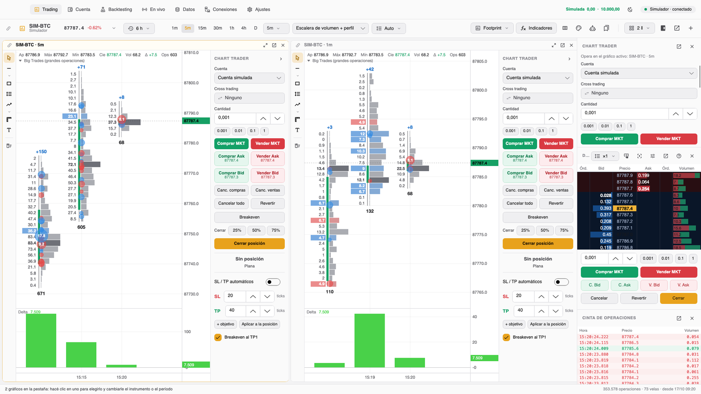

<div align="center">

# Trading Hub

**The free, open-source trading platform that runs 100 % on your Mac.**
Footprint charts, DOM trading, professional anti-overfitting backtesting and AI-powered strategies,
with your data and your keys always on your own computer.

Created by [**@ralphtradesz**](https://x.com/ralphtradesz)

On Windows? [See how to port it with Claude](#on-windows).

[](LICENSE)


</div>

---

## What it is

Trading Hub is a free, open-source desktop trading platform. Everything runs locally: the app, the data you record or
download, your strategies, the backtests and your broker keys (which go to the macOS Keychain, never to files). There
are no servers of our own, no accounts to create and no telemetry.

It works with **CME futures** (Rithmic, Tradovate and Databento history), **crypto** (Binance and Bybit, with free data
and no keys), **forex and CFDs** (OANDA, cTrader or CSV files) and **US stocks** (Alpaca).

The AI comes from **Claude Code with your own subscription** (no API keys): an assistant that writes strategies in C#,
compiles them, tests them and builds reports, plus an agent that allocates risk across your live strategies.

## Features

### Charts
- Time, tick, volume or range candles; candles, bars, line or Heikin Ashi.
- **Footprint** configurable column by column (bid/ask, delta, volume, POC, per-candle profile) with its own editor.
- DOM, time and sales tape, drawings and templates.
- Included indicators: moving averages, VWAP with deviations, Bollinger, RSI, MACD, volume, delta, cumulative delta
  (CVD), session volume profile and big trades. Add your own in C# (they recompile on save), compatible with the ATAS
  indicator API, plus those from ATAS or other public-source projects: see
  [More indicators](#more-indicators).
- **Replay** of any saved day, at whatever speed you like.

### Trading
- **Chart Trader** and DOM with market, limit and stop orders, brackets (stop and targets) and OCO.
- Simulated accounts included plus real accounts from your connections; history and statistics per account.
- On the simulated account nothing gets in the way of your click; on real accounts you can ask for a confirmation
  before each order (it can be turned off in Settings). Safety comes from risk limits.

### Data
- Everything you look at is recorded automatically, tick by tick, with the aggressor side.
- Downloads: public Binance and Bybit files, Rithmic history and history from your connections.
- **Databento**: years of CME futures tick by tick (pay per use, it shows you the cost first). It is stored separately
  and in backtests you choose **Rithmic only, Databento only or both combined** (Rithmic first, with Databento filling
  the gaps).
- CSV import from Dukascopy, HistData, MetaTrader or TradingView.

### Strategies and backtesting
- Strategies in **C#** with a built-in editor that compiles in milliseconds (Roslyn, with errors marked in the code)
  and a simple API: `EnterLong()`,
  `StopLossTicks`, indicators, time-of-day filters and market-context filters.
- Backtests over every real recorded trade, with commissions, slippage and realistic limit-order fills.
- **Bayesian optimization** (TPE) and **smart walk-forward**: it picks stable plateaus instead of peaks, compresses
  ticks to run faster and measures overfitting with **PBO (CSCV)** and **CPCV with embargo**. The library also ships the
  **deflated Sharpe ratio** and a full validation you can call from code.
- The **timeframe** is optimized like any other parameter (M1 to D1), and your **favourite** strategies stay at the top
  of the list.
- **Monte Carlo**, results **by market regime** (range, mixed or trend; low, normal or high volatility) and robustness
  metrics so you don't mistake luck for an edge.

### Live
- Run strategies on your accounts from the backtester or from a chart, with maximum size, daily loss and drawdown.
  On the chart you see how each one did historically: the real result with costs, a mini equity curve and all the
  statistics.
- Portfolios, a **risk agent powered by Claude** that proposes the size of each strategy (on real accounts you approve
  it yourself), the real-time condition of each market and a panel in the Mac menu bar.
- Automatic resume on launch and a no-sleep mode (also with the lid closed, if you want).

### Claude
- A chat that writes and fixes strategies, and a **lab** (an MCP server inside the app itself) where Claude runs
  backtests, optimizations and walk-forwards and leaves you a professional report with every metric.

## Screenshots

| | |
|---|---|
|  |  |
| Footprint with delta, POC and big trades | Chart Trader, DOM and time and sales tape |
|  |  |
| C# strategies with the Claude assistant | Backtesting with results by market regime |
|  |  |
| Tick-by-tick history and Databento | Light or dark theme |

## Installation

### The easy way: with Claude Code
If you have [Claude Code](https://claude.com/claude-code), open a Terminal in this folder, run `claude` and ask it:

```
Install Trading Hub on my Mac following CLAUDE.md.
```

It checks your Mac, installs whatever is missing (no administrator password), builds the app and drops it in
Applications. The step-by-step guide is in [INSTALL_WITH_CLAUDE_CODE.md](INSTALL_WITH_CLAUDE_CODE.md).

### By hand
You need an Apple Silicon Mac with macOS 12 or newer (for Windows, see [On Windows?](#on-windows)).

```bash
curl -sSL https://dot.net/v1/dotnet-install.sh -o /tmp/dotnet-install.sh
bash /tmp/dotnet-install.sh --channel 10.0
git clone https://github.com/ralphtradesz/trading-hub.git
cd trading-hub
./build-app.sh --install
```

The first build takes a few minutes. The app lands in `/Applications/Trading Hub.app` and starts with a simulated
account: nothing trades real money until you enable it in Connections. More details in
[docs/installation.md](docs/installation.md).

## On Windows?

Today Trading Hub builds for Apple Silicon Macs, but it is written with .NET and Avalonia, which also run on Windows:
the macOS-specific parts live in a handful of clearly identified places. With **Claude Code** you can port it on your
PC, in stages, with the tests green at every step.

1. Install on the PC (64-bit Windows 10 or 11): [Git](https://git-scm.com), the
   [.NET 10 SDK](https://dotnet.microsoft.com/download) and [Claude Code](https://claude.com/claude-code), and sign in
   with your Claude account.
2. Clone the repository and open a terminal in the folder:
   ```bash
   git clone https://github.com/ralphtradesz/trading-hub.git
   cd trading-hub
   claude
   ```
3. Paste the prompt below into Claude Code. It will separate what is platform-specific (keys in Credential Manager,
   no-sleep mode, system tray, Ctrl shortcuts, title bar), build and run the tests at the end of each stage, and leave
   you a `build-windows.ps1` that produces the app in `dist\Trading Hub`.
4. Try it first with the simulated account and the free Binance data.

<details>
<summary><b>See the full prompt for Claude Code</b></summary>

```
I want to port Trading Hub to Windows without breaking the macOS version. It is a C#/.NET 10 desktop app with
Avalonia and SkiaSharp (solution TradingHub.slnx). Read CLAUDE.md, README.md, docs/development.md and
PORTING_TO_WINDOWS.md first (it has the inventory of what depends on macOS and the stage-by-stage plan).

Rules:
- The macOS version has to keep building and working exactly as before. Separate platform-specific code with
  OperatingSystem.IsMacOS()/IsWindows() or, better, with small interfaces (ISecretStore, ISleepGuard, IShell, ISound)
  and one implementation per platform. Do not copy whole files.
- Never store keys, tokens or passwords in text files: on Windows use Credential Manager
  (advapi32 CredWrite/CredRead/CredDelete) or DPAPI. The tests must not touch real credentials: use an environment
  variable (like TRADINGHUB_KEYCHAIN_FILE on Mac) to point at a test store.
- Tools and tests never use the user's real data: the headless scenes already use temporary folders
  (TRADINGHUB_DATA_DIR, TRADINGHUB_STRATEGIES_DIR, TRADINGHUB_INDICATORS_DIR); keep it that way.
- Do not add confirmations that block clicks on the trading buttons; safety comes from risk limits.
- The interface is in English: keep new text in English too.

Do it in stages and at the end of each one build (dotnet build TradingHub.slnx), run the tests
(dotnet test tests/TradingHub.Tests) and tell me what you changed:
1. Make it build and start on Windows (Program.cs without the macOS splash wait, paths, fonts).
2. The Windows key store behind the same interface as the Keychain (Connections.cs).
3. Integrations: SleepGuard with SetThreadExecutionState, system tray (TrayIcon + GetCursorPos to position the
   panel), opening links/folders/reports with UseShellExecute, sounds without afplay, and Claude Code (find claude.exe
   or claude.cmd with `where`, %USERPROFILE%\.local\bin and %APPDATA%\npm; open /login in cmd or Windows Terminal).
4. Interface: title bar with the Windows buttons on the right, Ctrl shortcuts (one shared helper instead of
   KeyModifiers.Meta) and per-platform wording (Mac/PC, Keychain/Credential Manager, menu bar/tray).
5. A build-windows.ps1 that publishes self-contained for win-x64 and win-arm64 with the icon, and leaves the app ready
   in a dist\Trading Hub folder. If you can, an optional Inno Setup script.
6. Final check: unit tests, the relevant headless scenes
   (dotnet run --project tools/TradingHub.UiSnapshot -- captures 4 trading brokers panel footprint market)
   and a list of what is worth testing by hand with the simulated account.

If something cannot work the same way as on Mac (for example, keeping going with the lid closed), hide that option on
Windows and explain it in the Settings text. Show the real errors if something fails; do not carry on as if it had
worked.
```

</details>

The complete guide, with the inventory of every macOS-dependent part and what to use on Windows, is in
[PORTING_TO_WINDOWS.md](PORTING_TO_WINDOWS.md). If you pull it off, open a *pull request* so everyone can benefit!

## More indicators

Trading Hub ships its own indicators (moving averages, VWAP, Bollinger, RSI, MACD, volume, delta, CVD, volume profile
and big trades). Those from other platforms are not in the repository because their code does not carry a license that
allows redistribution, but **you can add them yourself** from their public source:

**All the ATAS ones at once** (about 250, from their public repository
[AtasPlatform/Indicators](https://github.com/AtasPlatform/Indicators)):

```bash
git clone https://github.com/AtasPlatform/Indicators.git third_party/ATAS-Indicators
python3 tools/port_atas.py
./build-app.sh --install
```

The script adapts the ATAS namespaces to the Trading Hub ones without touching the logic (and fixes a couple of details
so they compile), and they show up in the indicator library alongside the rest. To update them when ATAS publishes
changes: `git -C third_party/ATAS-Indicators pull` and repeat the last two steps. The two folders it creates are in
`.gitignore`, so they are not uploaded if you fork.

**A single one, from ATAS or any other public C# source:** copy the `.cs` into
`~/Documents/Trading Hub/Indicators`. Trading Hub compiles it on its own, adapts the ATAS namespaces and adds it to the
library. If it uses another indicator (for example, the ATAS CCI uses their SMA), copy that one too.

Those indicators belong to their authors: use them in line with each source's license. More details in
[docs/indicators.md](docs/indicators.md).

## Documentation

| | |
|---|---|
| [Installation](docs/installation.md) | Requirements, building, updating and uninstalling |
| [Getting started](docs/getting-started.md) | A tour of the app |
| [Connections](docs/connections.md) | Brokers, exchanges and data; real and simulated accounts |
| [Charts](docs/charts.md) | Periods, footprint, DOM, drawings, indicators and replay |
| [Trading](docs/trading.md) | Chart Trader, DOM, orders, brackets and accounts |
| [Insights](docs/insights.md) | The decision panel, danger gauge, edge meter, options and liquidation levels |
| [Data](docs/data.md) | Recording, downloads, Databento and CSV import |
| [Strategies](docs/strategies.md) | The C# API with examples |
| [Backtesting](docs/backtesting.md) | Backtest, optimization, walk-forward, PBO, CPCV and Monte Carlo |
| [Live](docs/live.md) | Strategies on your accounts, portfolios and the risk agent |
| [Claude](docs/claude-assistant.md) | The strategy assistant and the MCP lab |
| [Indicators](docs/indicators.md) | Included, your own and ATAS-API compatible |
| [Settings](docs/settings.md) | Every option |
| [Privacy](docs/privacy.md) | What stays on your Mac and what connects to the internet |
| [Development](docs/development.md) | Code structure, tests and scenes |
| [Porting to Windows](PORTING_TO_WINDOWS.md) | How to take it to Windows with Claude, with the full prompt |

## Support the project

Trading Hub is free and will stay that way. If it is useful to you and you want to support its development, you can
donate here:

| Coin | Network | Address |
|---|---|---|
| USDT | BEP20 (BNB Smart Chain) | `0xebedab9a1f6820914b0869e4126d5c54aa028a2a` |
| USDT | TRC20 (Tron) | `THAULimtnWpbQ8opZWxK8863nZEkyek4E5` |
| BTC | BEP20 (BNB Smart Chain) | `0xebedab9a1f6820914b0869e4126d5c54aa028a2a` |

Send each coin **only over the network listed**: anything sent over another network is lost. Thank you!

## Disclaimer

Trading the markets carries the risk of losing money. Trading Hub is a tool: it does not give investment advice and
backtest results do not guarantee future results. Always test with the simulated account first. The software is
provided "as is", without warranties (see the [license](LICENSE)).

## License

[MIT with the Commons Clause](LICENSE): you can use Trading Hub for free (including to trade your own money), modify it
and share it, always with the license notice. What you cannot do is **sell it**: not the app, not a modified version,
and not a paid service whose value comes from Trading Hub (for example, charging to install it, host it or support it).
Because of that condition it is not an «open source» license in the strict OSI sense: the code is public and free, but
it cannot be commercialized.

Indicators ported from other platforms that do not have an open license are not part of this repository, but you can
add them yourself from their public source (see [More indicators](#more-indicators)).

---

<div align="center">

Made with care by [**@ralphtradesz**](https://x.com/ralphtradesz)

</div>
